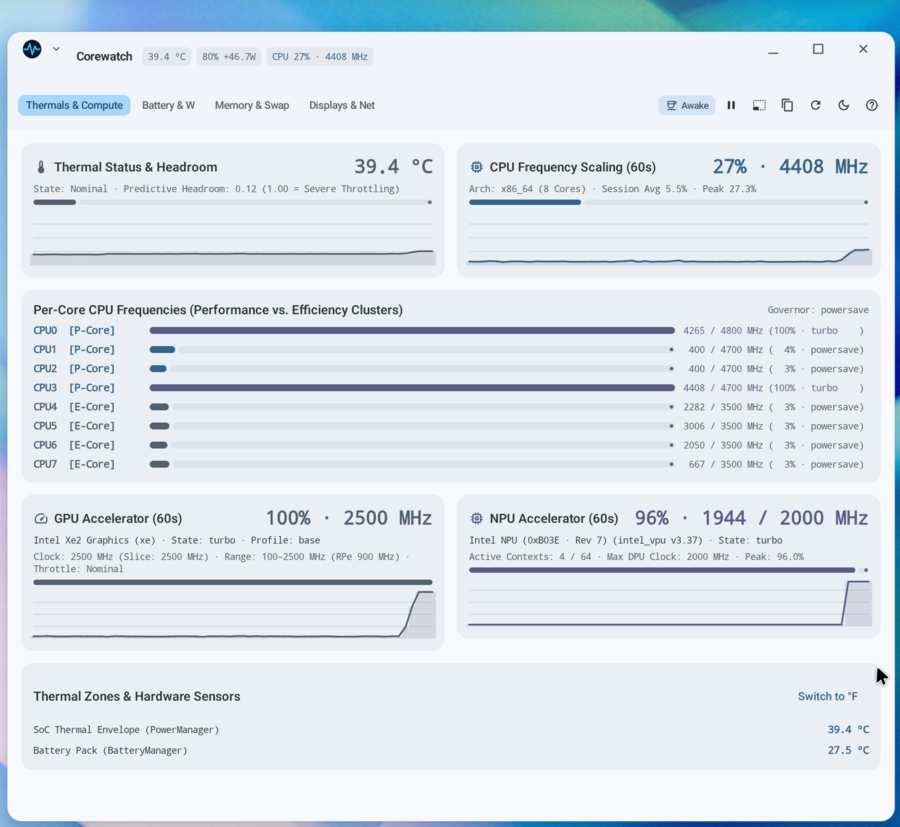
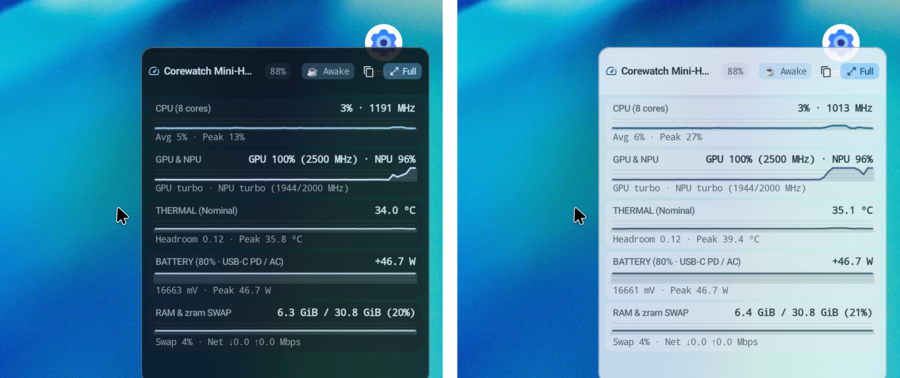
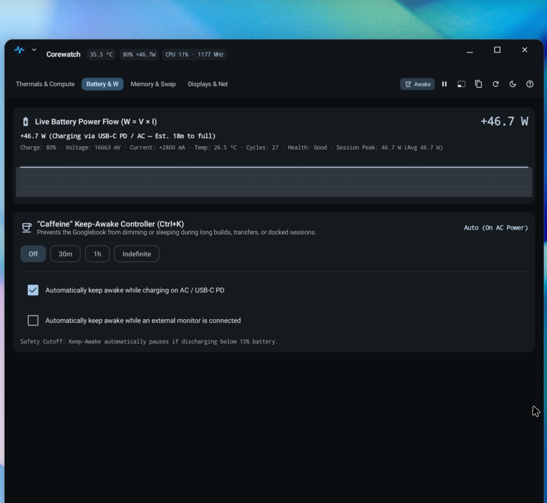
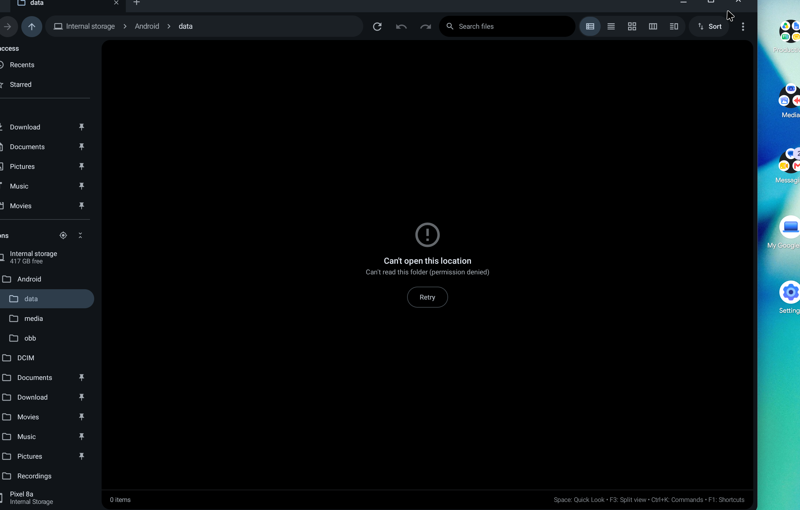
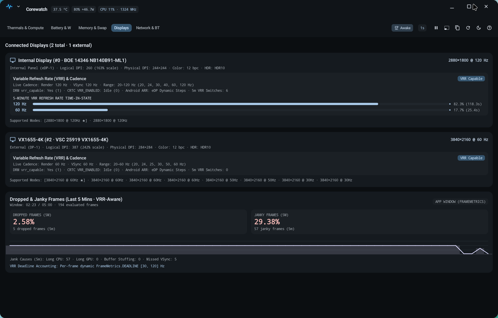
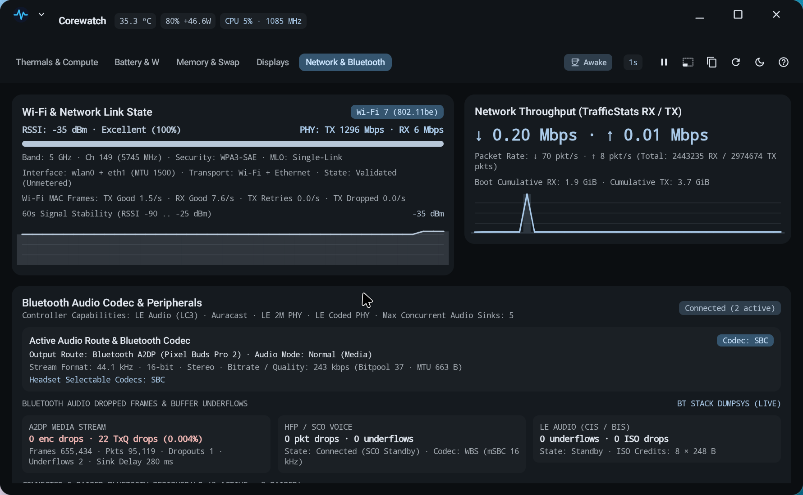
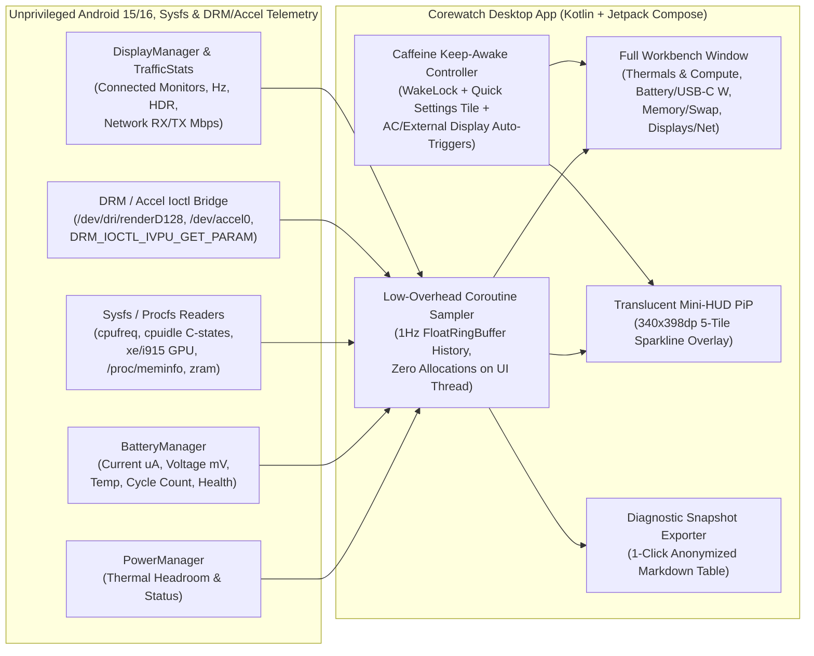

<p align="center">
  
</p>

<h1 align="center">Corewatch</h1>

<p align="center">
  <b>Compact system telemetry, CPU/GPU/NPU compute monitor, thermal/battery wattage inspector, Variable Refresh Rate (VRR) &amp; frame-jank auditor, Wi-Fi 7 &amp; Bluetooth audio codec/peripheral inspector, LMKD/PSI memory monitor, and "Caffeine" keep-awake utility for Googlebooks.</b><br>
  Real-time thermal headroom, CPU model identification &amp; per-core P/E CPU frequencies/C-state residency, live GPU (Render + Media engine) &amp; NPU hardware accelerator counters, USB-C PD battery wattage (<code>W = V × I</code>), Variable Refresh Rate (VRR) 5-minute time-in-state residency &amp; VRR-aware frame jank profiler, Wi-Fi 7 (<code>802.11be</code>) PHY link &amp; Bluetooth audio codec/peripheral telemetry, memory/<code>zram</code> swap/LMKD/PSI pressure, configurable sampling rates (<code>250ms | 500ms | 1s | 2s</code>), and a translucent Always-On-Top 340×398dp Mini-HUD: one universal download for Intel and Snapdragon Googlebooks.
</p>

<p align="center">
  <a href="../../releases/latest/download/Corewatch.apk"><b>⬇ Download Corewatch.apk</b></a>
  &nbsp;·&nbsp; <a href="#what-it-is">Features</a>
  &nbsp;·&nbsp; <a href="#mini-hud-and-workbench">Mini-HUD &amp; Workbench</a>
  &nbsp;·&nbsp; <a href="#caffeine-and-power">Caffeine &amp; Power</a>
  &nbsp;·&nbsp; <a href="#made-for-the-googlebook">Googlebook Design</a>
  &nbsp;·&nbsp; <a href="#keyboard-shortcuts">Shortcuts</a>
  &nbsp;·&nbsp; <a href="#limitations">Limitations</a>
  &nbsp;·&nbsp; <a href="#install">Install</a>
  &nbsp;·&nbsp; <a href="#privacy">Privacy</a>
  &nbsp;·&nbsp; <a href="#how-its-built">Architecture</a>
  &nbsp;·&nbsp; <a href="#licenses">Licenses</a>
</p>

<p align="center">
  
  
  
  
</p>

<p align="center">
  <sub>A personal passion project, proudly developed on and for a Googlebook in its Linux Terminal.<br>
  Not affiliated with, endorsed by, or sponsored by Google or any employer (<a href="#about-this-project">more</a>).</sub>
</p>

<p align="center">
  
  <br>
  <sub><b>Thermals &amp; Compute</b> workbench in Alabaster Light theme: live caption-bar telemetry pills, per-core P/E CPU frequencies, and dedicated GPU &amp; NPU hardware accelerator cards.</sub>
</p>

---

## What it is

**Corewatch** (`com.droid.corewatch`) brings the high-density hardware telemetry of **macOS Activity Monitor / iStat Menus**, **CoconutBattery**, and **Amphetamine** to Android laptops and Googlebooks. Built in modern Kotlin with Jetpack Compose and Material 3, Corewatch gives power users instant visibility into thermal headroom, per-core CPU frequencies, GPU & NPU hardware accelerators, USB-C PD charging wattage, memory/`zram` swap pressure, and external monitor negotiation—without oversized mobile typography:

* **Dual-layout desktop UI & Translucent Always-On-Top PiP Mini-HUD (`Ctrl+M`):**
  * **Full Workbench (`1120dp × 760dp`):** Live thermal/wattage/CPU telemetry badges drawn directly into Android 15's desktop caption bar with five diagnostic tabs (`Thermals & Compute`, `Battery & W`, `Memory & Swap`, dynamically singular/plural `Display` / `Displays`, and `Network & Bluetooth`), a **configurable polling rate selector (`250ms | 500ms | 1s | 2s`)**, and quick actions immediately below.
  * **Translucent Always-On-Top Mini-HUD (`340dp × 398dp`):** Ultra-dense floating Picture-in-Picture (`TYPE_APPLICATION_OVERLAY`) 5-tile sparkline dashboard (**CPU**, **GPU & NPU**, **Thermal**, **Battery**, and **RAM & `zram` Swap**) with **adjustable translucency (`88%` / `75%` / `100%`)**, drag-to-reposition header, and one-click `"↗ Full"` restore, using crisp `11sp`/`12sp` tabular monospace typography (`fontFeatureSettings = "tnum"`).
* **Thermal, per-core CPU, GPU & NPU hardware accelerator telemetry:**
  * Displays real-time **Thermal Status** (`Nominal`, `Light Throttling`, `Moderate Throttling`, `Severe Throttling`, `Critical Thermal`), predictive **Thermal Headroom** (`PowerManager.getThermalHeadroom(10)`), battery temperature (`°C` / `°F`), and world-readable `/sys/class/thermal/` and `/sys/class/hwmon/` sensors.
  * Identifies the exact **CPU Model Name** (e.g. `Intel Core Ultra 7 355` from `/proc/cpuinfo` or `Build.SOC_MODEL`) alongside live per-core CPU frequency bars and 60-second sparklines reading `/sys/devices/system/cpu/cpu*/cpufreq/scaling_cur_freq` and hardware C-state idle residency (`/sys/devices/system/cpu/cpu*/cpuidle/state*/time`), automatically classifying **Performance (`P-Core`)** and **Efficiency (`E-Core`)** clusters on hybrid Intel Core Ultra and Qualcomm Snapdragon processors.
  * **GPU & NPU Accelerator Counters:** Tracks live **GPU** active duty cycle (from `/sys/class/drm/card0/device/tile0/gt0/gtidle/idle_residency_ms`, Intel `i915` `rc6_residency_ms`, or Qualcomm Adreno `/sys/class/kgsl/kgsl-3d0/gpu_busy_percentage`), GuC SLPC operating vs. slice clocks (`cur_freq`, `act_freq`, `rpe_freq`, `rp0_freq`), **Intel Xe Media Engine (`tile0/gt1/freq0`) clock**, power profile, and hardware throttle reasons (`PL1`, `PL2`, `PL4`, `PROCHOT`, `THERMAL`), alongside **NPU** telemetry via unprivileged `/dev/accel0` DRM/Accel ioctls (`DRM_IOCTL_VERSION` & `DRM_IOCTL_IVPU_GET_PARAM` for PCI device/revision, max DPU clock rate, firmware version, zero-wakeup active context tracking via `DRM_IVPU_PARAM_CONTEXT_ID`, and engine heartbeat) and `/sys/class/accel/accel0/device/` counters.
* **Live battery wattage (`W = V × I`), USB-C PD profiler & drain tracker:**
  * Computes signed real-time power flow in Watts from `EXTRA_VOLTAGE` and `BATTERY_PROPERTY_CURRENT_NOW` / `BATTERY_PROPERTY_CURRENT_AVERAGE` (auto-normalizing microamps vs. milliamps across fuel-gauge drivers), displaying e.g. **`+46.6 W (USB-C PD / AC)`** or **`-8.4 W (Discharging — Est. 6h 15m remaining)`**.
  * Reports battery health, cycle count (`EXTRA_CYCLE_COUNT`), voltage (`mV`), current (`mA`), capacity (`%`), energy counter (`Wh`), and a 60-second session power curve.
* **"Caffeine" Keep-Awake controller (`Ctrl+K`) & Quick Settings Tile:**
  * One-click toggle in the caption bar and in the system Quick Settings tray (`CaffeineTileService`) to prevent the Googlebook from dimming or sleeping during compilations, large file transfers, or docked presentations.
  * Configurable timer modes (**30m**, **1h**, **Indefinitely**) plus smart auto-triggers (*Keep awake while charging on AC* and *Keep awake while an external display is connected*) with an automatic **`< 15%` low-battery safety cutoff**.
* **Variable Refresh Rate (VRR) 5-minute time-in-state, VRR-aware frame jank & external display auditor:**
  * Queries `DisplayManager.getDisplays()` and unprivileged `/dev/dri/card0` KMS properties (`DRM_IOCTL_MODE_GETCONNECTOR` & `DRM_IOCTL_MODE_OBJ_GETPROPERTIES`) to inspect the built-in eDP panel (`BOE NB140B91-ML1`, `12 bpc`) and every connected external monitor (`HDMI` / `USB-C DP Alt Mode`).
  * Reports **Variable Refresh Rate (VRR) & Cadence** telemetry: hardware `vrr_capable` and CRTC `VRR_ENABLED` states, Android Adaptive Refresh Rate (`hasArrSupport`), dynamic refresh range & discrete steps (e.g. **`20–120 Hz (20, 24, 30, 40, 60, 120 Hz)`**), live SurfaceFlinger render frame rate vs. physical panel VSync cadence (`Render 60 Hz · VSync 120 Hz`), **rolling 5-minute refresh-rate time-in-state residency bars & switch counter**, HDR capabilities (`Dolby Vision`, `HDR10`, `HDR10+`, `HLG`), and a **30Hz Dock Bottleneck Warning** whenever a `>= 1440p` external monitor is negotiated below `50Hz`.
  * **Dropped & Janky Frames (5m · VRR-Aware):** Evaluates per-frame `Window.OnFrameMetricsAvailableListener` deadlines (`FrameMetrics.DEADLINE`, CPU stage durations, and `GPU_DURATION`) against the active VRR cadence over a rolling 5-minute window, breaking down **Dropped Frames %**, **Janky Frames %**, a 60-second Jank % sparkline, and **Jank Causes** (`Long CPU`, `Long GPU`, `Buffer Stuffing`, `Missed VSync`).
* **Wi-Fi 7 (`802.11be`) Link State, Packet Throughput & Bluetooth Audio Codec / Peripheral Inspector (`Ctrl+5`):**
  * **Wi-Fi & Network Link State:** Uses non-intrusive install-time `ACCESS_NETWORK_STATE` and `ACCESS_WIFI_STATE` permissions (zero `INTERNET` and zero Location permission) to report **Wi-Fi Standard** (`Wi-Fi 7 (802.11be)`, `Wi-Fi 6/6E (802.11ax)`, `Wi-Fi 5 (802.11ac)`), **Band & Channel** (e.g. `5 GHz · Ch 149 (5745 MHz)` or `6 GHz`), **RSSI (`dBm`) & Signal Quality %** with a 60-second RSSI sparkline, **TX / RX PHY Link Speeds (`Mbps`)**, **WPA3-SAE / OWE Security**, **Wi-Fi 7 MLO (Multi-Link Operation) link count**, and **Wi-Fi MAC Frame Counters** (`TX Good/s`, `RX Good/s`, `TX Retries/s`, `TX Dropped/s`) alongside live `TrafficStats` `Mbps` and `pkt/s` throughput.
  * **Bluetooth Audio Codec, Dropped Frames & Peripherals:** Reports active audio output routing (`AudioManager.getDevices`), negotiated **Bluetooth A2DP / LE Audio codec** (`SBC`, `AAC`, `aptX`, `aptX HD`, `LDAC`, `LC3 (LE Audio)`, `Opus`), sample rate (`44.1`–`96.0 kHz`), bit depth (`16`/`24`/`32-bit`), channel mode, bitrate/quality (`990 kbps` LDAC, `243 kbps` SBC Bitpool 37, etc.), headset selectable codecs, controller hardware capabilities (`LE Audio (LC3)`, `Auracast`, `LE 2M PHY`, `LE Coded PHY`, max concurrent audio sinks), **per-profile Bluetooth Audio Dropped Frames & Buffer Underflows** across **A2DP Media** (`enc drops`, `TxQ drops`, `dropouts`, `underflows`, and `AVDTP Sink Delay ms`), **HFP / SCO Hands-Free Voice** (`pkt drops`, `underflows`, and speech codec `WBS mSBC 16 kHz` / `SWB LC3 32 kHz`), and **LE Audio (`CIS / BIS`)** (`underflows`, `ISO drops`, and controller `ISO Credits × Buffer Bytes`), plus connected/paired peripherals (`BLE GATT / HID`, `Dual BR/EDR + LE`) with live battery percentages.
* **Memory + `zram` swap + LMKD / PSI pressure & 1-click Markdown diagnostic copy (`Ctrl+Shift+C`):**
  * Parses `/proc/meminfo` (`MemTotal`, `MemAvailable`, `Cached`, `Buffers`, `SwapTotal`, `SwapFree`, `Dirty`), `ActivityManager.MemoryInfo` (**LMKD / AMS low-memory threshold** & `lowMemory` flag), **rolling 5-minute LMKD (Low Memory Killer Daemon) invocations** (via `EventLog` `am_kill` / `am_low_memory` when `READ_LOGS` is granted, or `ActivityManager.getHistoricalProcessExitReasons` + `onTrimMemory` fallback), and Linux `/proc/pressure/memory` PSI (`some` / `full` 10s averages) alongside live network throughput (`TrafficStats` RX/TX `Mbps`) and internal storage capacity.
  * Generates a clean, anonymized Markdown hardware & thermal diagnostic table on the clipboard for pasting directly into community forum threads or bug reports.

---

<h2 id="mini-hud-and-workbench">Mini-HUD (Translucent Always-On-Top PiP) &amp; Full Workbench</h2>

Corewatch transitions seamlessly between a multi-column desktop workbench and a translucent Always-On-Top Picture-in-Picture (PiP) Mini-HUD:

* **Translucent Always-On-Top Mini-HUD (`Ctrl+M`):** Toggling Mini-HUD (`Ctrl+M` or the title-bar Mini-HUD button) spawns a floating, Always-On-Top `340dp × 398dp` overlay (`TYPE_APPLICATION_OVERLAY` when "Display over other apps" is granted, or a translucent compact freeform window otherwise) with **clickable opacity cycling (`88%` → `75%` → `100%`)**, drag-anywhere positioning, and five stacked 60-second sparkline cards (**CPU**, **GPU & NPU**, **Thermal**, **Battery Wattage**, and **RAM & `zram` Swap**) that fit cleanly without scrolling. Clicking **`↗ Full`** immediately restores the Full Workbench window.
* **Zero-allocation ring buffers:** Time-series histories use fixed-capacity primitive circular buffers (`FloatRingBuffer`), rendering 60-second `Canvas` line and area sparklines at 1Hz without allocating `Path` objects on the UI thread.
* **Jitter-free tabular typography:** Every numeric metric uses OpenType tabular numerals (`tnum`) so live MHz frequencies, wattages, and throughput counters never shift horizontally as values update.

<p align="center">
  
  <br>
  <sub>Translucent Always-On-Top Mini-HUD PiP overlay (<code>88%</code> opacity, toggleable <code>88% / 75% / 100%</code>) in Dark Mode (left) and Light Mode (right) fitting all 5 telemetry tiles without scrolling.</sub>
</p>

<p align="center">
  
  <br>
  <sub><b>Memory &amp; Swap</b> tab showing physical RAM breakdown (<code>/proc/meminfo</code>), <code>zram</code> swap pressure, internal storage capacity, and rolling 5-minute <b>LMKD Invocations &amp; PSI Pressure</b>.</sub>
</p>

---

<h2 id="caffeine-and-power">Caffeine Keep-Awake &amp; USB-C Power Telemetry</h2>

Long compilations, container builds, and docked multi-monitor sessions shouldn't be interrupted by aggressive mobile screen-off timers or silent USB-C hub power drops:

* **Caption-bar & Quick Settings integration:** Toggle Caffeine from Corewatch's title bar (`Ctrl+K`) or add the **Corewatch Caffeine** tile to Android's system Quick Settings panel for instant access even when Corewatch is closed.
* **Rule-based keep-awake automation:** Enable **Auto-enable on AC / USB-C PD charging** or **Auto-enable when external monitor is attached** so your Googlebook stays awake automatically when docked at your desk and resumes normal battery-saving sleep the moment you unplug.
* **Low-battery protection:** Even if Indefinite mode or an external-display rule is active, Corewatch automatically releases its wake lock if battery charge drops below **15%** while discharging.

---

<h2 id="made-for-the-googlebook">Made for the Googlebook</h2>

Mobile system monitor apps were designed for narrow portrait phone screens with oversized cards and no awareness of desktop windowing. Corewatch is engineered specifically for Googlebook laptops and desktop setups:

* **Native Android 15+ desktop caption bar:** Corewatch opts into freeform caption-bar inset handling (`WindowInsets.Type.captionBar()`), dynamically keeping navigation tabs anchored on the left and status/action buttons clear of the system minimize/maximize/close controls across any window resize.
* **Keyboard-first workflow:** Every tab, mode switch, pause/resume toggle, counter reset, and clipboard export has a dedicated keyboard shortcut. Press `F1` or `?` anytime to view the interactive shortcut cheatsheet.
* **Expressive Dark, Light & System themes:** High-contrast Carbon Slate Dark theme by default for low glare in a corner HUD, plus crisp Alabaster Light and automatic System theme modes.

<p align="center">
  
  <br>
  <sub>Carbon Slate Dark theme on the <b>Thermals &amp; Compute</b> tab with live thermal headroom, per-core P/E CPU clusters, and 60-second GPU &amp; NPU accelerator telemetry under active compute load.</sub>
</p>

<p align="center">
  
  <br>
  <sub><b>Display / Displays</b> tab (dynamically singular or plural based on connected display count) inspecting hardware <b>Variable Refresh Rate (VRR) 5-minute time-in-state residency</b> and <b>Dropped &amp; Janky Frames (5m · VRR-Aware)</b>.</sub>
</p>

<p align="center">
  
  <br>
  <sub><b>Network &amp; Bluetooth</b> tab showing live <b>Wi-Fi 7 (802.11be)</b> link state (RSSI <code>-42 dBm</code>, <code>5 GHz · Ch 149</code>, <code>WPA3-SAE</code>, TX/RX PHY link speeds, MAC frame retry/drop counters), <b>TrafficStats RX/TX</b> packet rates, <b>Bluetooth Audio Codec (<code>SBC</code>)</b>, <b>A2DP / HFP / LE Audio Dropped Frames &amp; Buffer Underflows</b>, and <b>Connected &amp; Paired Bluetooth Peripherals</b>.</sub>
</p>

---

<h2 id="keyboard-shortcuts">Desktop Keyboard Shortcuts</h2>

| Shortcut | Action |
| :--- | :--- |
| `Ctrl+M` | Toggle between **Full Workbench** and **Compact Mini-HUD** mode |
| `Ctrl+1` .. `Ctrl+5` | Switch tabs: `1` Thermals & Compute, `2` Battery & Power, `3` Memory & Storage, `4` Display(s), `5` Network & Bluetooth |
| `Ctrl+K` | Toggle **Caffeine Keep-Awake** active state (`Off` ↔ `Indefinite`) |
| `Space` | Pause / Resume live telemetry sampling and graph scrolling to inspect a spike |
| `Ctrl+Shift+C` | Copy anonymized Markdown System & Thermal Diagnostic Snapshot to clipboard |
| `F5` / `Ctrl+R` | Reset session min/max/average telemetry counters and sparkline history |
| `F1` / `?` | Open the keyboard shortcuts cheatsheet dialog |

---

<h2 id="limitations">Known Limitations</h2>

Because Corewatch runs as a standard, unprivileged open-source Android application without root access or platform OS signing keys, a few Android SELinux (`untrusted_app`) security boundaries apply:

* **Vendor-Specific Thermal Zones & Fan RPMs:** Corewatch always reports official Android thermal status (`PowerManager.getCurrentThermalStatus()`), predictive thermal headroom (`PowerManager.getThermalHeadroom()`), battery temperature (`BatteryManager.EXTRA_TEMPERATURE`), and all world-readable `/sys/class/thermal/` and `/sys/class/hwmon/` nodes. On hardware where specific embedded-controller (EC) fan tachometers or vendor thermal zones are restricted by SELinux policy, Corewatch gracefully falls back to the standard `PowerManager` and `BatteryManager` thermal envelope telemetry.
* **Per-Process CPU Breakdown:** Android 10+ restricts `/proc/[pid]/stat` enumeration across other applications' processes for untrusted packages. Corewatch therefore focuses on hardware-level per-core CPU frequency scaling (`/sys/devices/system/cpu/cpu*/cpufreq/`), system-wide memory and `zram` swap pressure (`/proc/meminfo`), and total device network throughput (`TrafficStats`).

---

<h2 id="install">Install</h2>

**[⬇ Download Corewatch.apk](../../releases/latest/download/Corewatch.apk)** (universal pure-JVM APK for Intel `x86_64` and Snapdragon `arm64-v8a` Googlebooks).

1. **Download the APK:** Click the link above to download **`Corewatch.apk`**.
2. **Open the file:** Click the download notification in Chrome, or open `Corewatch.apk` in Wayfinder / Files from your `Downloads` folder.
3. **Allow install:** If Android asks to permit installing unknown apps, click **Settings**, enable **Allow from this source**, and tap **Install**.
4. **Optional Quick Settings Tile:** Open the system Quick Settings tray, click the edit (pencil) icon, and drag the **Corewatch Caffeine** tile into your active tiles for one-click keep-awake control from anywhere.

> **Updating:** Install newer versions of `Corewatch.apk` directly over your existing installation. Your Caffeine auto-trigger preferences will remain preserved.

---

<h2 id="privacy">Privacy &amp; Security</h2>

* **Zero internet permissions, zero location permissions, zero telemetry, zero ads:** Corewatch does not request `android.permission.INTERNET` or `android.permission.ACCESS_FINE_LOCATION` and contains no analytics, crash reporters, advertising SDKs, or third-party tracking scripts. All hardware telemetry stays 100% in memory on your device.
* **Minimal permission footprint:** Requests only `android.permission.WAKE_LOCK` (for the user-controlled Caffeine controller), install-time `ACCESS_NETWORK_STATE` & `ACCESS_WIFI_STATE` (for Wi-Fi 7 PHY link speed, RSSI, and MAC retry/drop counters without reading SSID/BSSID location data), `BLUETOOTH_CONNECT` (for inspecting negotiated A2DP/LE Audio codecs and connected Bluetooth peripheral battery levels, without `BLUETOOTH_SCAN`), and optional `android.permission.SYSTEM_ALERT_WINDOW` (used solely to float the translucent Always-On-Top Mini-HUD PiP overlay when Mini-HUD mode is toggled).
* **Anonymized diagnostic snapshots:** The `Ctrl+Shift+C` Markdown snapshot exporter includes only hardware model, CPU architecture, OS version, thermal/power/memory metrics, and display modes—never serial numbers, MAC/IP addresses, account names, or personal file paths. All strings are sanitized against Markdown table and control-character injection.
* **Strict backup exclusions:** App preferences are excluded from cloud backups and device-to-device transfers (`data_extraction_rules.xml` & `backup_rules.xml`).
* **Audited, fuzz-tested & 96.1% code coverage:** Backed by automated unit tests, headless Robolectric Compose UI tests across desktop and Mini-HUD window sizes (**96.1% overall line coverage**, **100% class coverage**), and property-based fuzzers (**125,000+ iterations** across `/proc/meminfo`, `cpufreq`, `thermal_zone`/`hwmon`, battery wattage math, display mode auditing, and Markdown escaping). See [SECURITY.md](SECURITY.md) for vulnerability reporting.

---

<h2 id="how-its-built">How it's built</h2>

Corewatch is written in 100% modern Kotlin with Jetpack Compose:



* **Language & Tooling:** Kotlin 2.3, Jetpack Compose BOM `2026.03.01`, Material 3, Gradle 9.1, Android SDK 36 (Android 15+ Desktop Windowing).
* **Pure Data & Telemetry Architecture (`com.droid.corewatch.data`):**
  * `SysfsParsers`: Defensive, bounds-checked parsers for `/proc/meminfo`, `/sys/devices/system/cpu/cpu*/cpufreq/`, `/sys/devices/system/cpu/cpu*/cpuidle/state*/time`, `/sys/class/drm/card0/device/tile0/gt0/` (`xe` / `i915` GPU), `/sys/class/accel/accel0/`, `/sys/class/thermal/`, and `/sys/class/hwmon/`.
  * `AccelIoctlBridge`: Lightweight 16KB page-aligned JNI bridge (`libcorewatch_accel.so` for `x86_64` and `arm64-v8a`) querying `DRM_IOCTL_VERSION` on `/dev/dri/renderD128` and `/dev/accel0`, KMS connector/CRTC VRR properties (`vrr_capable`, `VRR_ENABLED`, `max bpc`) on `/dev/dri/card0`, and zero-wakeup `DRM_IOCTL_IVPU_GET_PARAM` (`DRM_IVPU_PARAM_CONTEXT_ID`, `CORE_CLOCK_RATE`, `FW_API_VERSION`, `DEVICE_ID`) on Intel Lunar Lake / Meteor Lake NPUs.
  * `BatteryPowerCalculator`: Signed wattage (`W = V × I`), unit normalization (`µA`/`mA`, `mV`/`V`), charger profiling, and remaining charge/discharge time estimation.
  * `DisplayAuditor`: Variable Refresh Rate (VRR / eDP Adaptive-Sync / Android ARR) range and live cadence auditing, EDID panel model & color depth (`bpc`), DPI scale, HDR format mapping, and `< 50Hz` dock bottleneck detection.
  * `CaffeinePolicy`: Pure state evaluator for timed keep-awake modes, AC/external-display auto-triggers, and the `< 15%` low-battery safety cutoff.
  * `DiagnosticReportBuilder`: Anonymized, Markdown-injection-safe hardware and thermal snapshot formatter.

```bash
# Clone and build directly in the Googlebook Linux Terminal
git clone https://github.com/alainmic/corewatch.git
cd corewatch
./gradlew assembleDebug                                          # Builds app/build/outputs/apk/debug/Corewatch-debug.apk
./gradlew testDebugUnitTest createDebugUnitTestCoverageReport    # Runs all unit, UI, and fuzz tests + JaCoCo report
```

---

## Made on a Googlebook

Corewatch was created, built, and tested directly on a Googlebook:

* **Developed in the Linux Terminal:** Kotlin sources, Gradle builds, unit/UI/fuzz test suites, and APK packaging were executed inside the Googlebook's built-in Linux environment.
* **Tested headlessly and live on-device:** Verified both on-device in freeform desktop windowing and headlessly via Robolectric Compose UI tests across full workbench (`1120×760dp`) and compact Mini-HUD (`340×398dp`) window geometries.
* **Universal multi-architecture APK:** Ships with 16KB page-aligned `x86_64` and `arm64-v8a` JNI ioctl bridges (`< 6 KB` each) alongside pure Kotlin fallbacks so a single lightweight APK runs natively on both Intel Core Ultra and Qualcomm Snapdragon Googlebooks.

---

<h2 id="about-this-project">About this project</h2>

**Corewatch** is an independent, open-source passion project developed on and for Googlebooks to give Googlebook users compact, desktop-grade visibility into thermals, per-core CPU frequencies, battery wattage, memory swap pressure, and external display negotiation.

It is **not affiliated with, endorsed by, or sponsored by Google or any employer**. See [CONTRIBUTING.md](CONTRIBUTING.md) if you'd like to contribute.

---

<h2 id="licenses">Licenses</h2>

* **Corewatch source code:** Licensed under the [Apache License, Version 2.0](LICENSE).
* **Third-Party Libraries:** Built using open-source AndroidX, Jetpack Compose, Kotlin, Guava `ListenableFuture`, and JSpecify libraries. Complete license texts and attributions are available in [THIRD_PARTY_NOTICES.md](THIRD_PARTY_NOTICES.md).

<p align="center"><sub>Crafted with passion on a Googlebook, for the Googlebook community.</sub></p>
